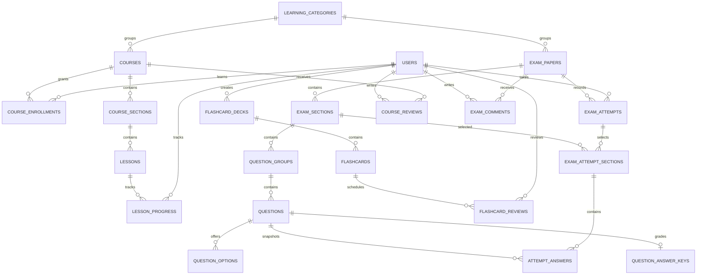

# Chuyển sang nền tảng học online và luyện thi

Đây là ghi nhận đợt đầu ngày 21/10. Xem [bổ sung ngày 22/10/2026](STUDY4-REFERENCE-SCREENS.md) và [hướng dẫn SQL mới/nâng cấp](NHAP-PHPMYADMIN.md) để dùng bản hiện tại.

Ngày khảo sát: 21/10/2026. Phạm vi đợt này: cơ sở dữ liệu, quan hệ Eloquent, dữ liệu minh họa và kiểm thử. Giao diện học/luyện thi và thanh toán sẽ triển khai trên nền dữ liệu này ở đợt tiếp theo.

## Căn cứ khảo sát

- [Trang chủ STUDY4](https://study4.com/): khóa học nổi bật, giá, đánh giá và các đề thi mới.
- [Thư viện đề](https://study4.com/tests/): tìm kiếm, thẻ đề có thời lượng, số phần, số câu và nhãn kỹ năng.
- [Chi tiết đề Listening](https://study4.com/tests/6842/ielts-collection-1-listening-test-1/): chọn từng phần để luyện, giới hạn thời gian tùy chọn, chế độ full test và bình luận.
- [Chi tiết khóa học](https://study4.com/courses/26/ielts-fundamentals/): chương trình chia chủ đề/bài học, học thử, quyền truy cập có thời hạn và học từ vựng bằng flashcard.

Chỉ khảo sát các trang công khai. Không có quyền truy cập database hoặc mã nguồn STUDY4; thiết kế bên dưới là thiết kế riêng suy ra từ chức năng quan sát được. Không sao chép ngân hàng câu hỏi, âm thanh hay nội dung khóa học của họ. Dữ liệu demo được tự biên soạn và không đại diện cho đề thi chuẩn.

## Hiện trạng mã nguồn ZIP

`composer.json` yêu cầu PHP ^8.3 và Laravel ^13.17; thông tin Laravel 10/11 trong tài liệu cũ không phản ánh mã hiện tại. Có 7 bảng nghiệp vụ: users, teachers, students, courses, class_rooms, enrollments, attendances. Chưa có bài học, câu hỏi, lượt làm bài hoặc flashcard. ZIP không chứa bản sao dữ liệu thực tế; seeder hiện có chỉ tạo dữ liệu quản lý trung tâm.

Các hướng dẫn cài đặt, phân công nhóm và kế hoạch trong tài liệu ZIP là thông tin nền, không phải yêu cầu mới của người dùng. Lựa chọn của người dùng trong chat là chuyển sang nền tảng học và luyện thi, bắt đầu từ database.

## Quyết định chuyển đổi

1. Giữ `users` và vai trò admin/teacher/student. Tài khoản học online liên kết thẳng `users`, không bắt buộc có hồ sơ `students` hoặc đăng ký lớp.
2. Mở rộng `courses` bằng danh mục, slug, cách học, giá và ngày xuất bản. Khóa cũ mặc định `classroom`; khóa mới có `delivery_mode=online`. Không tự đổi học phí lớp thành giá khóa online.
3. Giữ 6 bảng quản lý trung tâm còn lại trong giai đoạn chuyển tiếp. Không xóa hay đổi khóa chính của dữ liệu cũ. Chỉ gỡ giao diện/bảng cũ sau khi chuyển dữ liệu và luồng sử dụng hoàn tất.
4. `course_enrollments` là quyền học online; `enrollments` cũ vẫn là ghi danh lớp. Không suy ra quyền học online từ một dòng ghi danh lớp hoặc một đơn chưa thanh toán.
5. Thêm migration mới, không viết lại lịch sử migration. Triển khai với `php artisan migrate`; không dùng `migrate:fresh` trên database có dữ liệu cần giữ.

## Ánh xạ giao diện và dữ liệu

| Màn hình/chức năng | Bảng chính | Quy tắc |
| --- | --- | --- |
| Danh mục IELTS/TOEIC | learning_categories | slug duy nhất, bật/tắt danh mục |
| Trang khóa học, giá, nội dung giới thiệu | courses | khóa online chỉ hiển thị khi active và đã xuất bản |
| Mục lục khóa học, bài học thử | course_sections, lessons | thứ tự trong từng cha là duy nhất; bài preview không cấp quyền toàn khóa |
| Khóa học của tôi | course_enrollments | duy nhất user/khóa; kiểm tra trạng thái và thời hạn ở thời điểm truy cập |
| Học tiếp, hoàn thành bài | lesson_progress | duy nhất user/bài, lưu vị trí và lần truy cập cuối |
| Thư viện đề | exam_papers, learning_categories | lọc danh mục/kỹ năng/trạng thái; thời lượng lưu bằng giây |
| Chọn phần thi | exam_sections | phần thuộc đúng một đề |
| Bài đọc/nhóm câu hỏi | question_groups, questions, question_options | nội dung chung ở nhóm; câu hỏi có thứ tự; đáp án lựa chọn dùng nhãn A/B/C |
| Chấm điểm | question_answer_keys | tách đáp án/rubric khỏi dữ liệu câu hỏi công khai |
| Luyện tập/full test | exam_attempts, exam_attempt_sections | lưu chế độ và các phần đã chọn; khóa ngoại ghép ngăn chọn phần của đề khác |
| Trả lời, xem kết quả | attempt_answers | mỗi câu chỉ một dòng trong lượt; khóa ngoại ghép ngăn trả lời câu ngoài phần đã chọn |
| Ôn từ vựng | flashcard_decks, flashcards, flashcard_reviews | lịch ôn riêng user/thẻ, truy vấn thẻ đến hạn qua due_at |
| Đánh giá khóa học, thảo luận đề | course_reviews, exam_comments | lưu người viết và trạng thái kiểm duyệt; chỉ hiển thị published |

## Quan hệ tổng quát

## Các nguyên tắc dữ liệu

- Bảng con nội dung dùng khóa ngoại `restrict` để không xóa nhầm nội dung đang được sử dụng. Dùng trạng thái archived/is_active để ngừng xuất bản. Xóa một lượt làm bài có thể xóa phần/câu trả lời của chính lượt đó.
- Khóa ngoại ghép nối `exam_paper_id` giữa lượt và phần thi; nối `exam_section_id` giữa nhóm/câu hỏi và câu trả lời. Các cột lặp này phục vụ kiểm tra tính nhất quán ngay ở database.
- Giá và điểm dùng decimal. CHECK (hoặc trigger tương đương trên SQLite) kiểm tra giá, thời lượng, thứ tự, điểm tối đa, điểm đạt được và khoảng ngày hợp lệ.
- JSON chỉ dành cho giá trị có cấu trúc biến thiên: đáp án chấp nhận, lựa chọn đã trả lời, rubric và bản chụp. Quan hệ chính vẫn dùng khóa ngoại.
- `question_answer_keys` và `attempt_answers.grading_snapshot` chứa dữ liệu chấm điểm riêng. Models ẩn dữ liệu này khi chuyển JSON, nhưng API tương lai vẫn phải dùng Resource/DTO và phân quyền; `$hidden` không thay thế kiểm soát truy cập.
- Khi bắt đầu lượt, backend phải chụp `prompt_snapshot`, `options_snapshot`, `grading_snapshot`, `max_points` và nội dung nhóm vào các bảng của lượt. Đây là điều kiện cần để việc sửa đề không sửa lịch sử.
- Mỗi lượt lưu `started_at`, `time_limit_seconds`, `submitted_at`, `elapsed_seconds`. Backend tương lai quyết định hạn nộp theo thời gian máy chủ, không tin bộ đếm phía trình duyệt.
- `scaled_score` để trống cho đến khi có bảng quy đổi đã xác minh theo loại đề. Không gán band IELTS hay điểm TOEIC từ vài câu demo. Writing/Speaking cần chấm theo rubric; không tự chấm bằng so khớp chuỗi.
- Lịch ôn lưu ease_factor, interval_days, repetitions, due_at và last_reviewed_at. Thuật toán cập nhật lịch ôn triển khai ở tầng nghiệp vụ sau; database không tự chạy spaced repetition.
- Số câu, số phần, số lượt và điểm đánh giá trung bình tính từ dữ liệu liên quan; không seed số liệu marketing giả.

## Ranh giới đợt này

Hoàn thành cấu trúc lưu trữ và dữ liệu minh họa. Chưa đổi trang chủ, chưa có màn làm đề/bộ đếm, API nộp bài, dịch vụ chấm điểm, thanh toán, email hay nội dung có bản quyền. Các bảng không tự tạo các chức năng đó.

Các bước tiếp theo: (1) danh mục và thư viện đề công khai; (2) dịch vụ bắt đầu/lưu/nộp/chấm bài có phân quyền và giao dịch; (3) trang kết quả và lịch sử; (4) màn học/tiến độ và flashcard; (5) quản trị nội dung; (6) đơn hàng, dòng hàng, giao dịch thanh toán và cấp quyền học sau webhook đã xác thực. Thanh toán và combo khóa học cần các bảng thương mại riêng, không dùng `paid_tuition` của lớp cũ.

## Kết quả kiểm tra ngày 21/10/2026

- Thêm 19 bảng nghiệp vụ, mở rộng `courses`, với 4 migration có chiều hoàn tác và 19 model mới.
- Chạy đầy đủ 106 kiểm thử / 288 assertions: đạt. Trong đó 37 trường hợp kiểm tra phần dữ liệu online và khả năng tương thích; các kiểm thử còn lại kiểm tra chức năng cũ.
- Chạy migration thật vào `database/learning-demo.sqlite`, chạy seeder online hai lần: dữ liệu không nhân đôi; `PRAGMA foreign_key_check` không phát hiện vi phạm.
- Kiểm tra hoàn tác 4 migration mới rồi nâng cấp lại với dữ liệu lớp học cũ; giữ các khóa chính và trigger kiểm tra khóa học.
- Bổ sung thông báo khi người dùng xóa khóa học/tài khoản đã có dữ liệu online, tránh trang lỗi do khóa ngoại. Có kiểm thử cho hai đường xóa này.
- Dữ liệu thử trong `MemberOneTest::classPayload` của ZIP thiếu `expected_end_date`, trong khi controller gốc đã yêu cầu trường này. Bổ sung đúng ngày từ factory để các kiểm thử cũ tiếp tục kiểm tra nghiệp vụ dự kiến.
- Môi trường kiểm tra: PHP 8.5.11, Laravel 13.36.0 theo composer.lock, SQLite. Máy không có MySQL đang chạy; chưa xác nhận thực thi các migration trên MySQL. Cần chạy lại kiểm thử trên MySQL phát triển trước khi triển khai thật.

Đọc [README](../README.md) để cài đặt trên máy khác. File `.env` và database SQLite demo chỉ phục vụ máy phát triển hiện tại, không nằm trong ZIP mã nguồn bàn giao.
